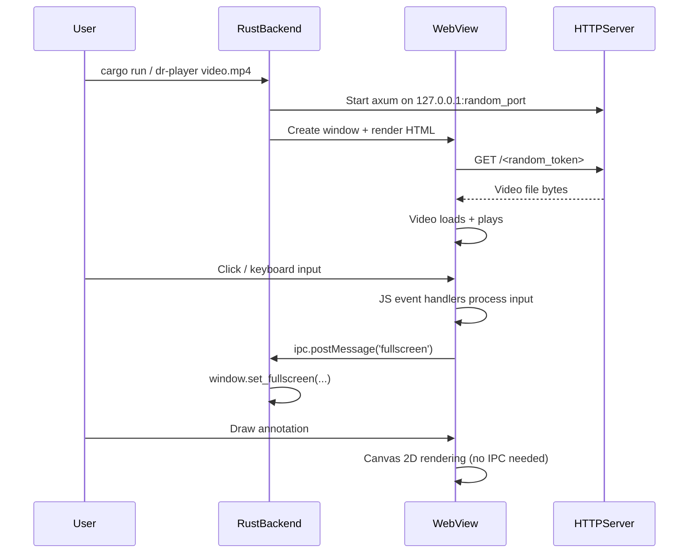

# Dr.Player

A desktop video player you can draw on top of. Windows, macOS and Linux.

> ### Video formats
>
> **MP4, MOV and WebM play on Windows, macOS and Linux, though HEVC inside MP4 needs Microsoft's free add-on on Windows. MKV plays on Windows and Linux, but not on macOS, and 3GP plays on Linux only. `.avi`, `.wmv`, `.flv`, `.mpg`, `.mpeg`, `.m2v`, `.vob`, `.mts`, `.m2ts`, `.ts` and `.ogv` play on neither Windows nor macOS, and some of them can play on Linux.** Check the codec inside your file, not only its extension.
>
> | Your file | Windows | macOS | Linux |
> |-----------|:-------:|:-----:|:-----:|
> | `.mp4` with H.264 video and AAC audio | ✓ | ✓ | ✓ |
> | `.mp4` with AV1 video | ✓ | ✓ | ✓ |
> | `.mp4` with HEVC / H.265 video | ✓ only with Microsoft's free HEVC add-on | ✓ | ✓ |
> | `.mov` with H.264 video | ✓ | ✓ | ✓ |
> | `.webm` with VP8 or VP9 video | ✓ | ✓ | ✓ |
> | `.mkv` with H.264 video | ✓ | ✗ | ✓ |
> | `.3gp` with H.264 video and AAC audio | ✗ | ✗ | ✓ |
> | `.avi`, `.wmv`, `.flv`, `.mpg`, `.mpeg`, `.m2v`, `.vob`, `.mts`, `.m2ts`, `.ts`, `.ogv` | ✗ | ✗ | some of them, with the right GStreamer plug-ins |
>
> A tick means the format plays. A cell with words in it is conditional, and the words say what it depends on. Four Windows cells were played on Windows 11 with WebView2 Runtime 154: H.264 in MP4, H.264 in MOV, VP8 and VP9 in WebM, and H.264 in MKV. The other four Windows cells, and every macOS and Linux cell, come from each platform's documented engine support and were not tested. `.3gp` is the one row the Windows cell turns down: Chromium's own documented format list marks it Google Chrome OS only, and no `.3gp` fixture ships in `TESTING_videos/` to measure it here. Every Linux cell also depends on which GStreamer plug-ins your distribution installed (`gst-plugins-good`, `gst-libav`, `gst-plugins-bad`). HEVC on Windows is the one combination here that keeps a documented failure, `0xC00DB3B3`.
>
> Dr.Player does not decode video itself, so what plays is a property of your operating system rather than of this app. A container that plays can still fail on the codec inside it: an `.mkv` holding MPEG-4 Part 2 (DivX or Xvid) is refused even though MKV itself is fine.
>
> On Windows, installing puts Dr.Player into Explorer's Open with menu, the Open with dialog and Settings > Default apps for `.mp4`, `.m4v`, `.mov` and `.webm`. Windows keeps that choice itself, so installing changes nothing about what double-clicking opens; Dr.Player becomes the default only once you pick it once in Windows' own UI, which the installer's finish page offers to open for you. Every format outside those four has to be named on the command line, `dr-player <video-file>`.
>
> When a file will not play, **Error loading video** replaces the file name at the top left of the window and the video area stays black. It means the engine in your operating system's webview refused the file, and the same words appear for a damaged file, so they do not say which of the two happened. Those words fade after three seconds without mouse movement and come back as soon as you move the mouse. Converting to H.264 video with AAC audio in an MP4 container works on all three systems; HandBrake is free and does it.

---

## Purpose

Dr.Player provides a lightweight, secure video player that lets users watch local video files and draw annotations directly on the video canvas. It solves the problem of needing to visually mark up video frames for presentations, tutorials, or review without requiring external screen annotation tools.

The project is intended for:
- **Content creators** who need to annotate video during review
- **Educators** who want to highlight parts of a video during a presentation
- **Developers** who need a cross-platform embedding example using wry + tao
- **Anyone** who wants a simple, single-binary video player with drawing tools

---

## Features

- **Windows file associations** — the installer registers Dr.Player for `.mp4`, `.m4v`, `.mov` and `.webm`, so it appears in Explorer's Open with menu, in the Open with dialog, and in Settings > Default apps. Windows reserves the choice itself, in `Explorer\FileExts\<ext>\UserChoice`, which the installer writes nothing near, so it takes nothing away from a program you already use
- **Video playback** with play/pause, seek, frame stepping, volume control
- **Waveform seek bar** — the seek strip draws the actual audio waveform of the file, decoded on a background thread so clicking to seek is available from the first moment the window opens. The waveform fills in from the left over a few seconds as the decode runs, tall where the audio is loud and flat where it is quiet. Files with no audio, or containers the decoder cannot read, fall back silently to the plain line that the bar always was; there is no spinner, no error, and no empty box
- **Frame stepping at the file's own rate** — the step is measured from the video itself through `requestVideoFrameCallback`, with the old fixed 1/60 second behind it for an engine that never calls back, so 24, 25, 30, 50, 60 and 120 fps source all step by one frame. The video element is still not asked to seek to a frame and does not promise to land on one
- **Resume playback position** — a chip over the picture with one button on it, labelled `Continue from 00:12:34`, offering to carry on from where a file was left, while the video plays from 0:00 as always. Written on pause and when the window is closed through its own close button. Cleared rather than written when a video reaches its end, so a finished file is never offered back, and a file reaching its end is the only thing that clears one at all: the chip's own ten seconds and a click anywhere on the picture both take the chip away and change nothing else, because neither of them is a refusal. Never written while loop is on. It is not put up at all when there is nothing worth putting it up for, and none of the four is a decision the viewer makes: a position barely into the file, where a prompt would be noise over the opening; a file the viewer has already watched most of the way through and is opening again to watch it whole, which is why the usual rule that hides only the last few seconds is the wrong one here; a stored position past where the file now ends, which is what a file that has since been replaced by a shorter one looks like; and an entry whose recorded size no longer matches the file on disk, so a name that now belongs to different video inherits nothing. Hiding the chrome on purpose, with H or the eye button, takes the chip down with it, because someone who asked for a clean screen should not be left with a button over it, and bringing the chrome back inside the chip's own ten seconds brings the chip back. The three second idle fade leaves it alone, because hiding it there too would cut a ten second window down to three and the offer would be a flash rather than something to read
- **Window size and position memory** — the last size and position are restored on the next launch, with the position dropped and the window opened centred on the primary monitor at the same size if the remembered rectangle would not land entirely on a monitor that is connected now, which matters more here than in most players because this window is frameless and a restored window on a monitor that has gone has no title bar to drag it back with. A remembered size that comes back under 200x120 falls back to the default instead, because that is the smallest shape that still holds both bars without them overlapping, so a remembered window is always big enough to grab. No window geometry is recorded while the window is full or while fill mode is shaping it, because then the window's size belongs to the monitor or to the video rather than to the owner. A playback position is still written in those two states, which rewrites the whole state file and carries the last remembered rectangle over it untouched, so what is on file goes on saying what the window looked like when its size was the owner's own
- **6 drawing tools**: Pen (freehand), Line, Arrow, Rectangle, Circle, Hand (select/move)
- **Undo/redo** (50-level history) via toolbar buttons or mouse buttons 3/4
- **Custom color picker** with 6 preset swatches + HTML color picker
- **Stroke size** slider, 1–20; the number keys `0`–`9` reach the even sizes in that range, 2 to 20
- **Mid-draw tool switching** — incomplete shapes are automatically cleaned up
- **Draggable drawing toolbar** — repositionable via drag handle
- **Global keyboard shortcuts**: Space, arrows, `,`/`.`, F/F11, M, L, C, H, `[`/`]`, `/`, and Escape, which is the one key here that means a different thing in each of the three states it can arrive in, and is described the same way in every one of them rather than as the single thing a shortcut list would like it to be: it asks the window to leave fullscreen while the video is playing, it closes the shortcuts panel while that panel is up, and it closes draw mode while the draw bar is. The panel is registered ahead of the player handler and takes the key there, so a dialog is never left standing with its own way out going somewhere else, and the draw handler sits behind both. It is not a way out of the resume chip either, which goes away for good on its own ten seconds, on a click anywhere on the picture, or on its own button, and Escape is none of those three. Every binding here is a bare key and no modifier is tested anywhere in the handler. That is a choice rather than a limit: WebView2 holds back a fixed set of its own chords and never delivers those to the page, which is what made the Ctrl+H this file once used dead, while other chords do arrive, plain Ctrl+letter among them. A shortcut label promising a chord the engine swallows is worse than one that does not, so the labels name the key rather than the character it makes on a layout
- **Keyboard shortcuts panel** on `/` or the help button
- **Draw mode** that isolates all draw keyboard shortcuts (prevents conflicts)
- **Loop toggle** (single video repeat)
- **Fullscreen** mode (F or F11 to toggle it, Escape to leave it)
- **Custom window chrome** — frameless window with drag, resize (all edges), minimize, close
- **Hide the on-screen controls** with H or the eye button, with a stage drag so the window still moves
- **Fill mode** (C) — reshapes the window to the video's own shape instead of cropping the picture
- **Intelligent Auto-hiding UI** — top bar and bottom HUD fade after 3s of inactivity while playing, and stay visible on pause for convenient inspection
- **Hold-for-Speed & Floating Pill Indicator** — press and hold Spacebar or mouse/screen to temporarily fast-forward playback (YouTube style), showing a floating speed pill (e.g. `2x`), cleanly hiding controls during hold and keeping them hidden on release
- **Glassmorphic Playback Speed Controls** — modern speed panel with full-range slider (0.06x to 16x), direct custom input box, quick preset buttons (1.5x, 2x, 3x, 4x), and global persistence of the temporary speed setting
- **Optional update check** — one HTTPS GET per launch, opens the releases page, silent inside PDEA
- **macOS WKWebView crash mitigations**: deferred cursor mutations, custom dialogs, autoplay config
- **Error resilience**: global JS error handlers, Rust panic hook
- **Random security token** — video served via ephemeral localhost URL with 16-char random token
- **Content Security Policy** restricting media/connect sources to localhost

---

## Tech Stack

| Category | Technology |
|----------|-----------|
| Language | Rust 2021 edition, JavaScript (ES6) |
| Runtime | Rust (native desktop binary) |
| WebView | wry 0.39 (WebView2 on Windows, WKWebView on macOS, WebKitGTK on Linux) |
| Windowing | tao 0.28 |
| HTTP Server | axum 0.7 (embedded, single-route) |
| Async Runtime | tokio 1 (multi-thread, net features) |
| CLI Parsing | clap 4 (derive) |
| Serialization | serde_json 1 |
| Random | rand 0.8 |
| Icon Loading | ico 0.3 |
| Build Resources | winres 0.1 (Windows .ico embedding) |
| Audio Decode | symphonia 0.6 (AAC, MP3, isomp4, plus Vorbis, FLAC, ADPCM, PCM, MKV, OGG, WAV from defaults) |
| TLS client | reqwest 0.12 with rustls-tls (no OpenSSL) |
| Installer | NSIS (installer/DrPlayer.nsi) |
| File associations | Windows registry under `HKCU\Software\Classes`, plus one value under `HKCU\Software\RegisteredApplications`, written by the installer, per user, never elevated |
| Persistent storage | One portable JSON file (`state.json`) stored directly in the executable's directory (with automatic migration from `%APPDATA%`), holding window geometry, playback position per file, and global temporary speed setting. No database, no schema, nothing to migrate |
| No External APIs | One optional metadata GET to the GitHub releases API |

---

## Project Structure

```
Dr.Player/
├── src/
│   ├── main.rs                  # Application entry point: the embedded HTML/CSS/JS UI and all backend wiring
│   └── waveform.rs              # Audio waveform extractor: decodes the file's own audio track on a background thread
├── installer/
│   └── DrPlayer.nsi             # NSIS installer; version passed in with -DAPP_VERSION
├── docs/
│   └── WEBVIEW_QUIRKS.md        # Cross-platform webview quirk documentation
├── resources/
│   └── icon.ico                 # Application icon (Windows .ico format)
├── TESTING_videos/              # 13 test video files across 5 formats
│   ├── download_test_videos.ps1 # PowerShell script to fetch test videos
│   ├── inventory.csv            # Catalog of test videos with sources
│   └── RESEARCH_NOTES.md        # Research notes on test video sources
├── .github/
│   └── PULL_REQUEST_TEMPLATE.md # Code review checklist for PRs
├── .githooks/
│   └── pre-commit               # Pre-commit hook (tab check, cargo check)
├── .gitignore                   # Ignores target/, node_modules/, IDE, OS files
├── Cargo.toml                   # Rust project manifest, and the source of truth for the version
├── Cargo.lock                   # Rust dependency lockfile
├── build.rs                     # Windows resource compilation (embeds icon.ico)
├── RELEASE_NOTES.md             # v3.0.0, v2.2.0, v2.1.1, v2.1.0, v2.0.0, v1.0.0, v0.2.0 and v0.3.0 release notes
├── TESTING.md                   # Manual QA testing guide
├── LICENSE                      # Copyright notice
└── README.md                    # This file
```

### Key File Explanations

**`src/main.rs`** — The application entry point and orchestration layer. Contains:
- A `const HTML: &str` embedding the complete HTML, CSS, and JavaScript UI
- All Rust backend code for CLI parsing, window management, HTTP server, the optional update check, and IPC
- `mod waveform;` at line 2, pulling in the extractor below

**`src/waveform.rs`** — The audio waveform extractor. Runs on one detached background thread, reads the file's own first audio track through symphonia, and emits peak batches to the page over the existing event-loop proxy. Has no knowledge of the window, the webview, or any UI.
- `build.rs` — On Windows, compiles `resources/icon.ico` into the binary as the application icon

**`docs/WEBVIEW_QUIRKS.md`** — Documents known cross-platform issues with WKWebView (macOS), WebKitGTK (Linux), and WebView2 (Windows), along with their workarounds.

**`TESTING.md`** — Step-by-step manual QA guide covering macOS-specific tests, draw mode operations, keyboard shortcut conflicts, cross-platform matrix, crash resilience, regression checklist, and the resume position, window memory and frame stepping checks.

**`RELEASE_NOTES.md`** — Documents changes in v2.2.0, v2.1.1, v2.1.0, v2.0.0 and v1.0.0, and says at the top which of its entries are records of what shipped and which, the v0.2.0 and v0.3.0 ones, are reconstructions.

**`installer/DrPlayer.nsi`** — NSIS installer for Windows. Installs into the current user's profile, so no administrator rights are needed. The version is not written in the script; it is passed in with `-DAPP_VERSION=x.y.z`, taken from `Cargo.toml`. The installer also registers the Windows file associations described under Installation, and it writes no file associations outside the user's own profile.

---

## Architecture

### Overall Design

Dr.Player is a **single-binary native desktop application** that combines:

1. **Rust backend** — window management (tao), webview rendering (wry), embedded HTTP server (axum), CLI parsing (clap)
2. **Embedded web UI** — a complete HTML/CSS/JavaScript application stored as a Rust string constant, rendered inside the system's native webview

```
┌───────────────────────────────────────────────────────┐
│                  Dr.Player Binary                      │
│                                                        │
│  ┌──────────────┐    ┌──────────────────────────┐     │
│  │   CLI Parser  │    │     tao Event Loop        │     │
│  │   (clap)      │    │  (Window Management)      │     │
│  └──────┬───────┘    └────────┬──────────────────┘     │
│         │                     │                        │
│         ▼                     ▼                        │
│  ┌──────────────────────────────────────────┐          │
│  │            wry WebView                    │          │
│  │  ┌──────────────────────────────────┐    │          │
│  │  │  Inline HTML / CSS / JavaScript  │    │          │
│  │  │  (const HTML in main.rs)         │    │          │
│  │  │                                  │    │          │
│  │  │  ┌────┐  ┌────────┐  ┌───────┐  │    │          │
│  │  │  │Video│  │Drawing │  │ HUD / │  │    │          │
│  │  │  │Player│  │Canvas  │  │ TopBar│  │    │          │
│  │  │  └────┘  └────────┘  └───────┘  │    │          │
│  │  └──────────────────────────────────┘    │          │
│  └──────────────────────────────────────────┘          │
│         ▲                                             │
│         │ IPC (window.ipc.postMessage)                 │
│         ▼                                             │
│  ┌──────────────────────────────────────────┐          │
│  │  Embedded axum HTTP Server               │          │
│  │  (127.0.0.1:random_port)                 │          │
│  │  Serves video file via /{token}          │          │
│  └──────────────────────────────────────────┘          │
└───────────────────────────────────────────────────────┘
```

### Request/Response Flow

1. **Launch**: User opens a video. On Windows that means double-clicking it, which reaches Dr.Player only where it has already been chosen as the default in Windows' own UI, or picking Dr.Player from an Open with menu, which the installer's registration is enough for and which needs no such choice; everywhere it means naming the file on the command line, `dr-player <video-file>`
2. **Video Serving**: Rust starts an axum HTTP server on `127.0.0.1:<random_port>` bound only to localhost. A random 16-character alphanumeric token is generated. The video file is served at `http://127.0.0.1:<port>/<token>`
3. **UI Loading**: wry creates a webview and renders the inline HTML. An initialization script sets `window.loadVideo(url)`, `window.setTitle(filename)` and `window.setResumePosition(seconds)` on `DOMContentLoaded`
4. **Video Playback**: The browser's `<video>` element loads the URL from the embedded server and plays it
5. **User Interaction**: All keyboard/mouse events are handled by JavaScript event listeners inside the webview
6. **IPC Communication**: JavaScript calls `window.ipc.postMessage(message)` to communicate with Rust for window operations (close, minimize, fullscreen, exit_fullscreen, drag_window, resize)
7. **Rust Processing**: The `with_ipc_handler` closure receives messages and manipulates the tao window



### State Management

All application state lives in JavaScript variables within the webview:

- **Video state**: `vid.paused`, `vid.currentTime`, `vid.volume`, `vid.muted`, `loopEnabled`
- **UI state**: `hideT` (auto-hide timer), `hudLock` (chrome pinned off), `hudPin` (chrome held up), `helpOpen` (shortcuts panel), `updateDismissed`
- **Window shape state**: `fillMode`, `videoAspect`, `fillOwnResize` — fill mode's own bookkeeping, so a resize it did not ask for can be told from one it did
- **Drawing state**: `tool`, `color`, `size`, `drawing`, `shapes[]`, `undoStack[]`, `redoStack[]`, `selShape`, `selShapeOffX/Y`
- **Window state**: `resizing`, `resizeDir`, `startX/Y`, `startW/H`, `dragData`
- **Resume state**: `resumeSaved` (the seconds the window handed over, or null), `resumeTimer` (the chip's own ten seconds, and null once they have run out), `resumeWritten` (the last position written, so a pause inside half a second of the previous one is not a second write), `resumeSuppressed` (the chip is down because the chrome is, and an unhide may put it back)

The Rust side holds almost no application state. What the event-loop closure carries is the tao window, for minimise, fullscreen, drag and resize, the wry webview, for the two `evaluate_script` calls and for `update_available`, and the two things the app remembers between launches: the window's geometry and the per-file playback positions, which are read once at startup, written on the settle timer and on the way out, and handed to the page as a single number on `DOMContentLoaded`. The proxies go elsewhere: the event loop's own proxy is moved into the IPC handler, which uses it to forward each incoming message onto the event loop, and a clone of it is moved into the update-check task, which uses it to carry the answer back.

### Drawing State Machine

The drawing system operates as a state machine:

- **States**: `idle` (drawbar closed), `ready` (drawbar open, no active draw), `drawing` (mouse button held, building shape), `dragging` (Hand tool moving a selected shape)
- **Transitions**: Tool switch mid-draw resets `drawing` to false and discards incomplete shapes (zero-length lines, single-point pen strokes)
- **Undo/Redo**: Stack-based with 50-entry depth limit. `saveDrawState()` snapshots `shapes[]` via `JSON.parse(JSON.stringify())` before each new draw action. `redoStack[]` is cleared when a new draw action occurs after undo.
- **Selection**: The Hand tool uses `hitTest()` with a 12-pixel threshold for bounding-box and point-based hit detection.

### Authentication & Security

- The video URL includes a **random 16-character alphanumeric token** (`rand::distributions::Alphanumeric`)
- The axum HTTP server **binds only to `127.0.0.1`** (localhost-only)
- A **Content Security Policy** restricts `media-src` and `connect-src` to `http://127.0.0.1:*`
- No user authentication required. The only outbound request the app ever makes is the optional update check, one HTTPS GET per launch to the GitHub releases API, and a copy bundled inside PDEA makes none

### Error Handling Strategy

**JavaScript side** (the inline script in `src/main.rs`):
- `window.addEventListener('error', ...)` — catches all unhandled JS errors, logs them as `GLOBAL_ERROR`, calls `preventDefault()` to suppress propagation
- `window.addEventListener('unhandledrejection', ...)` — catches unhandled promise rejections, logs them as `UNHANDLED_PROMISE`, calls `preventDefault()`

**Rust side**:
- `std::panic::set_hook()` — installs a custom panic hook that prints `Dr.Player internal error: {info}` to stderr instead of crashing silently

**Edge case handling**:
- `switchTool()` — if `drawing` is true, it stops the draw, checks the last shape for completeness (zero-length line/arrow/rect/circle, single-point pen), and discards it if incomplete
- `window.blur` event — resets all drag/resize/seek/draw state to prevent dangling state when window loses focus
- `mouseleave` on canvas — sets `drawing = false` and clears selection to prevent extending strokes when mouse re-enters
- Autoplay fallback — if the initial `vid.play()` promise is rejected (audio autoplay blocked), the video is muted and playback retried
- Video error handler — `vid.onerror` writes `Error loading video` into the in-page title element, not the OS window title, which is fixed at `Dr.Player` and never changes
- The rate field's keydown handler — calls `e.stopPropagation()` so a keystroke aimed at the field does not fire a player shortcut instead
- The resume panel's keydown and mousedown handlers — stop for the same reason, so Space on a focused Continue does not resume and toggle playback at once, and a press on the panel does not become a window drag
- The state file — any parse failure falls back to nothing remembered and any write failure is dropped, so neither a corrupt file nor a full disk can stop the app from opening or from closing

---

## Core Components

### Rust Backend (`src/main.rs`)

| Component | Responsibility |
|-----------|----------------|
| `Args` (clap Parser) | Parse the video file path from CLI arguments |
| `load_icon()` | Load and decode the `.ico` file for the window icon |
| `is_postable_size()` | Reject a size whose width or height is not a finite number of at least 1. Guards both a posted resize and a size read back from the state file; it is not a clamp and never limits how small a window may be made live |
| `push_fullscreen_state()` | Push the window's real fullscreen state into the page, since the window owns that state |
| `is_embedded_copy()` / `beside_an_electron_bundle()` | Decide whether this is a standalone copy or one bundled inside PDEA |
| `newer_release_published()` | One HTTPS GET of the latest-release metadata, with a 5s ceiling and no retries |
| `parse_version()` / `is_newer_release()` | Read MAJOR.MINOR.PATCH off a tag, trimming surrounding whitespace and dropping a leading `v` or `V`, and answer whether the tag is newer than the running build. Equal is not newer, and anything that will not parse into three numbers answers no |
| `open_in_default_browser()` | Hand a URL to the shell, so the video never leaves the window |
| `main()` | Application entry point — servers, windows, event loop |


**`main()` flow:**
1. Install Rust panic hook (`std::panic::set_hook`)
2. Parse CLI argument (video file path) via clap derive parser
3. Canonicalize the path with `std::fs::canonicalize`, falling back to the path as typed when that fails, so a file the app cannot resolve still reaches the server rather than ending the launch
4. Extract filename for window title via `PathBuf::file_name()`
5. Generate random 16-char alphanumeric token via `rand::thread_rng().sample_iter(Alphanumeric).take(16)`
6. Build axum Router with a single route `/{token}` serving the file via `tower_http::services::ServeFile`
7. Bind TCP listener to `127.0.0.1:0` (random port, localhost only)
8. Spawn axum server in background tokio task
9. Build tao event loop with user event support (`EventLoopBuilder::<String>::with_user_event()`)
10. Create frameless, resizable window (the remembered inner size, or 1280×720 logical pixels on a first run) with application icon
11. Put the window back where it was left, if that rectangle still fits entirely on a monitor that is connected now, and otherwise open it centred on the primary monitor at the same size
12. Build wry webview with:
    - Inline HTML (the entire UI as a `const HTML: &str`)
    - DevTools disabled (`with_devtools(false)`)
    - Autoplay enabled (`with_autoplay(true)`)
    - Windows: `--autoplay-policy=no-user-gesture-required` via `with_additional_browser_args`
    - Initialization script to set video URL, title and resume position on `DOMContentLoaded`
    - IPC handler forwarding messages to event loop proxy
13. Run event loop handling:
    - `CloseRequested` → `ControlFlow::Exit`
    - User events: close, minimize, fullscreen toggle, exit_fullscreen, drag_window, update_available, open_release_page, `fill_mode:on`/`fill_mode:off`, `resume_save:{seconds}` and `resume_clear`, and `resize:{w}:{h}`, which takes any finite width and height of at least 1

### Embedded JavaScript Modules (the inline `<script>` in `src/main.rs`)

The inline `<script>` block contains all application logic organized into these functional modules:

#### Video Player Module
- **Elements**: `<video id="v">`, HUD buttons (play/pause, seek -5s/+5s, frame step -1F/+1F, rate field, volume, loop, fullscreen)
- **Key functions**: `showUI()`, `updateSeekbar()`, `seekFromEvent()`, `paintWaveform()`, `setVol()`, `volFromE()`
- **Events**: `timeupdate`, `loadedmetadata`, `play`, `pause`, `ended`, `onerror`
- **Autoplay fallback**: Attempts unmuted playback; if rejected, mutes and retries

#### Playback Rate Module
- **Field**: `#rate-input`, `role="spinbutton"`, `aria-valuemin="0.0625"`, `aria-valuemax="16"`, six characters wide so `0.0625` and `16.00` fit
- **Range**: the engine's own bounds, `RATE_MIN = 0.0625` and `RATE_MAX = 16`, not a round subset of them
- **Keys inside the field**: arrows step the rate, PageUp/PageDown step it a page, Enter commits, Escape leaves the rate in effect, Home and End are left to the caret. Every one of them stops propagating first, so typing `0.0625` does not fire a shortcut instead

#### Window Management Module
- **Drag**: `drag-handle` and `.title-capsule` mousedown → `window.ipc.postMessage('drag_window')`, plus a press on `#stage` while the chrome is hidden, so a hidden window can still be moved
- **Resize**: Edge detection within an 8px margin, direction tracking (n/s/e/w combinations), `requestAnimationFrame`-throttled IPC resize messages. No upper or lower clamp beyond the window system's own
- **Buttons**: minimize (`'minimize'`), close (`'close'`), fullscreen (`'fullscreen'`) via IPC
- **Blur handler**: Resets `resizing`, `seeking`, `vDrag`, `dragData`, `drawing`, `selShape` on window blur

#### Drawing State Machine Module
- **State variables**: `tool`, `color`, `size`, `drawing`, `shapes[]`, `undoStack[]`, `redoStack[]`, `selShape`, `selShapeOffX/Y`
- **Functions**:
  - `drawShape(ctx, s)` — renders a single shape object (pen, line, arrow, rect, circle, text)
  - `renderAll()` — clears canvas and redraws all shapes
  - `saveDrawState()` — pushes snapshot of `shapes[]` to `undoStack[]` (max 50), clears `redoStack[]`
  - `undoDraw()` — pops `undoStack[]` to `shapes[]`, pushes current to `redoStack[]`
  - `redoDraw()` — pops `redoStack[]` to `shapes[]`, pushes current to `undoStack[]`
  - `clearDrawCanvas()` — saves state, empties `shapes[]`
  - `getDrawPos(e)` — maps mouse coordinates to canvas coordinates
  - `hitTest(x, y)` — 12px threshold hit test across all shapes (bounding box for line/rect/arrow/circle, point distance for pen, measureText width for text)
  - `openDrawMode()` — activates canvas, opens drawbar, pauses video, sets cursor
  - `closeDrawMode()` — deactivates canvas, clears all shapes and stacks, closes drawbar
  - `switchTool(t)` — completes/cleans up current draw, activates new tool, updates cursor
  - `handleDrawKeydown(e)` — keyboard shortcuts isolated to draw mode context
- **Canvas events**: `mousedown`, `mousemove`, `mouseup`, `mouseleave`, `wheel`
- **Mouse button handlers**: Button 3 (back) → undo, Button 4 (forward) → redo; blocked during active drawing

#### Text Dialog Module
- Present in the source and wired to a `tool === 'text'` branch, but not reachable: there is no text tool button in the toolbar and no key that selects it
- **Elements**: `#text-dialog` (overlay), `#text-dialog-input` (text input), OK/Cancel buttons
- **Promise-based**: `showTextDialog()` returns a Promise that resolves to the entered text or `null`
- **Events**: OK/Cancel buttons, Enter key confirms, Escape key cancels, `stopPropagation()` prevents draw mode interference

#### Keyboard Shortcut Module
- **Shortcuts panel**: `/` or the help button opens it, the same key or a click outside closes it, and Tab moves through it
- **Player handler**: Listens for `keydown`; bails out early if the shortcuts panel is open or the draw bar is. Handles H (hide/show controls), C (fill mode), `[` and `]` (rate), Space, Arrow keys, Period/Comma (frame step), F/F11 (fullscreen), Escape (leave fullscreen), M (mute), L (loop toggle). Switches on `e.code`, so it is layout-independent, and tests no modifier: WebView2 holds back a fixed set of its own chords and never delivers those to the page
- **Draw handler**: Fourth `keydown` listener on `document`, after the one that re-shows the chrome and the shortcuts-panel and player handlers, and the only one that fires when the draw bar is open. Handles P/L/A/R/C/H (tool switch), Escape (leave draw mode), Delete (delete the picked-up shape), Backspace (clear all, still undoable), 0-9 (stroke size, the even sizes 2 to 20)
- **Shortcut isolation**: Draw mode shortcuts are completely separate from global shortcuts. When the draw bar is open, the player handler returns early before processing any key. When the draw bar is closed, the draw handler returns early.

#### UI Auto-Hide Module
- `showUI()` — shows topbar and HUD, resets the 3-second auto-hide timer
- `mousemove` and `keydown` events trigger `showUI()`; the timer re-checks that focus is not inside the chrome before it fires, so nothing invisible can be tabbed into
- `hudLock` (the eye button in the top bar) — pins the chrome off, so the auto-hide timer stops bringing it back; `hudPin` holds it up after `H` brings it back, until the mouse moves

### Embedded HTTP Server (`src/main.rs`)

- **Framework**: axum 0.7 with tower-http 0.5 (`ServeFile`)
- **Route**: `/{token}` nests `ServeFile::new(&path)`
- **Binding**: `tokio::net::TcpListener::bind("127.0.0.1:0")` — random port, localhost only
- **Lifetime**: Runs in a background tokio task spawned with `tokio::spawn`; lives as long as the application

---

## APIs

### IPC API (JavaScript → Rust)

The application uses a single IPC channel via `window.ipc.postMessage()`.

| Message | Purpose | Rust Handler |
|---------|---------|--------------|
| `'close'` | Close the application window | Writes the remembered geometry and positions one last time, then `*control_flow = ControlFlow::Exit` |
| `'minimize'` | Minimize the window | `window.set_minimized(true)` |
| `'fullscreen'` | Toggle fullscreen | `window.set_fullscreen(Some(Fullscreen::Borderless(None)))` if not already fullscreen, else `window.set_fullscreen(None)` |
| `'exit_fullscreen'` | Exit fullscreen | `window.set_fullscreen(None)` |
| `'drag_window'` | Start window drag | `window.drag_window()` |
| `'resize:{w}:{h}'` | Resize window to given dimensions | Parses width and height, keeps any finite pair of at least 1, calls `window.set_inner_size(LogicalSize::new(w, h))` |
| `'fill_mode:on'` / `'fill_mode:off'` | Tell the window whether fill mode is shaping it | Sets a flag. While it is on, no window geometry is recorded, because a shape fill mode chose is the video's shape and not a size the owner picked |
| `'resume_save:{seconds}'` | Record where playback was left in this file | Parses the number, drops anything that is not one or is not past the start, then stores it against this launch's path, which is the canonical one where the file could be resolved and the path exactly as typed where it could not, together with the file's size, evicts the oldest entry past 200 files, and writes the state file |
| `'resume_clear'` | Forget this file's saved position | Removes the entry and writes the state file, and only if there was one. The page sends this when the video reaches its end, which is now the only thing that sends it |
| `'open_release_page'` | Open the releases page in the default browser | `ShellExecuteW` with the open verb on Windows, and the platform's own launcher, `open` on macOS and `xdg-open` on Linux, elsewhere. Never the webview, so the video is not navigated away from under the person watching it |
| `'wave_ready'` | Signal that the webview page is ready to receive waveform batches | Spawns a background thread to decode audio via symphonia and emit peak batches to the event loop |

**Response format**: No return value (fire-and-forget). Messages are forwarded from `with_ipc_handler` to the tao event loop via `proxy.send_event()`.

**Error handling**: IPC handler uses `let _ = proxy.send_event(...)` to discard send failures. The resize handler silently ignores malformed messages (fewer than 3 colon-separated parts, or non-numeric values). The two resume handlers ignore anything they cannot use as a number.

### HTTP API

| Method | Route | Purpose | Response |
|--------|-------|---------|----------|
| GET | `/{random_token}` | Serve the video file | Raw video file bytes with content type determined by `ServeFile` |

### Outbound HTTP

| Method | Endpoint | Purpose |
|--------|----------|---------|
| GET | `https://api.github.com/repos/Babar-Meet/Dr.Player/releases/latest` | Optional update check, one request per launch under a 5s ceiling, no retries. Skipped entirely when `DRPLAYER_EMBEDDED` is set to a value other than an empty string, `0`, `no`, `false` or `off`, or when the executable sits beside an `app.asar`, i.e. when it is the copy bundled inside PDEA |

---

## Environment Variables

| Variable | Effect |
|----------|--------|
| `DRPLAYER_EMBEDDED` | The value is trimmed and lower-cased, then matched against the empty string, `0`, `no`, `false` and `off`. Any of those five forces the update check on; any other value forces it off. Only a variable that is absent altogether leaves the answer to the probe for a sibling `app.asar`, so `DRPLAYER_EMBEDDED=` set to nothing is not the same as not setting it |

Everything else is compile-time or CLI-based, with one exception that is read rather than set: the state file is found under `%APPDATA%` on Windows, `$HOME/Library/Application Support` on macOS, and `$XDG_CONFIG_HOME` or `~/.config` on Linux, so those three variables decide where Dr.Player keeps what it remembers.

---

## Database

Not applicable. There is no database and no schema to migrate.

There is one file, `state.json`, in the OS config directory of the user running the app — `%APPDATA%\Dr.Player\state.json`, `~/Library/Application Support/Dr.Player/state.json`, `$XDG_CONFIG_HOME/Dr.Player/state.json` or `~/.config/Dr.Player/state.json`. The install directory is owned by the installer and can be read-only, so nothing is written beside the binary. The file holds two things: the window's remembered geometry in logical pixels, and one entry per video file with the playback position it was left at, that file's size in bytes where the file could be measured, and the time the entry was last written. At most 200 files are kept, and the least recently written entry is dropped to make room. The size is what a canonical path cannot give — a name can come to mean a different file — and it is compared only when both sides know theirs, so a file that cannot be measured is the one case where a stored position is still trusted.

Every failure is silent and none of them can stop the app: a missing file, a file that will not open, a file that is not JSON, and a file that is JSON but has none of the numbers in it all mean "nothing remembered", which is how the app opened before the file existed. A write that fails is not worth a dialog. The file is written beside itself and renamed over it, so a write cut short leaves the previous one whole.

---

## Configuration

### `Cargo.toml`
- **Package**: `dr-player`, Rust 2021 edition. The `version` field here is the source of truth for the project version. One other build input carries a copy of the number: the usage comment at the top of `installer/DrPlayer.nsi` shows `makensis "-DAPP_VERSION=2.1.1" installer\DrPlayer.nsi`. See Release order for why that copy has to be moved in step with this one.
- **Dependencies**: clap 4 (derive), tokio 1 (rt-multi-thread, macros, net), axum 0.7, tower-http 0.5 (fs), wry 0.39 (fullscreen), tao 0.28, ico 0.3, serde_json 1, rand 0.8, reqwest 0.12 (rustls-tls, default features off), symphonia 0.6 (features = ["aac", "isomp4", "mp3"], default features kept)
- **Build deps**: winres 0.1 (Windows only)

### `installer/DrPlayer.nsi`
- `APP_VERSION` is not defined in the script. It is passed in with `-DAPP_VERSION=x.y.z`, read from `Cargo.toml`, and the default is a visibly wrong sentinel (`0.0.0-UNSET`) so a bare `makensis` cannot produce a plausible version by accident
- One optional section registers the Windows file associations described under Installation. NSIS selects it by default because the `/o` switch is omitted from its `Section` declaration, and the user can untick it on the components page
- The shell is told about the change with `SHChangeNotify(SHCNE_ASSOCCHANGED)` on the way in and on the way out, via `${NotifyShell_AssocChanged}` from `Integration.nsh`. Without it the change can go unnoticed until after a reboot
- The finish page's Run checkbox opens Windows' own Default Apps page rather than starting the app, which cannot be started bare. It is unchecked by default (`MUI_FINISHPAGE_RUN_NOTCHECKED`), and `MUI_FINISHPAGE_RUN` is defined without a value so that `MUI_FINISHPAGE_RUN_FUNCTION` runs an `ExecShell` instead of an `Exec`, since a URI is neither an exe nor something `Exec` can resolve
- A `.onVerifyInstDir` callback refuses an install directory that is not a local fixed drive, which is what keeps a typed `\\Server\Share\Dr.Player` out of the handler for four file types. It reads two characters of the path and nothing else: a colon followed by a separator
- The uninstaller deletes `$INSTDIR\dr-player.exe.WebView2` recursively before removing `$INSTDIR`, because that profile is created at runtime by the embedded browser and `RMDir` will not remove a directory that still has anything in it

### `build.rs`
- On Windows (`CARGO_CFG_TARGET_OS == "windows"`): compiles `resources/icon.ico` as the application icon via `winres::WindowsResource`

### `src/main.rs` (runtime constants)
- `RESIZE_MARGIN = 8` — pixel margin for edge detection during window resize
- `MAX_HISTORY = 50` — maximum undo/redo stack depth
- `RATE_MIN = 0.0625`, `RATE_MAX = 16` — the engine's own playback-rate bounds
- `FRAME_RATES = [24, 25, 30, 50, 60, 120]`, `FRAME_RATE_TOLERANCE = 0.02` — the rates a measured frame interval is snapped to when it lands within 2 per cent of one, and the fallback `FRAME_INTERVAL_FALLBACK = 1/60` used wherever `requestVideoFrameCallback` never delivers a measurement. There is one source and one fallback; `getVideoPlaybackQuality` is not a source, for the reason under Known Limitations
- `RESUME_MIN_SECONDS = 5`, `RESUME_END_FRACTION = 0.9`, `RESUME_TIMEOUT_MS = 10000`, `RESUME_WRITE_EPSILON = 0.5` — the two refusals on offering a saved position, how long the offer stays up, and how far playback must move before another write is worth making
- `DEFAULT_WINDOW_WIDTH/HEIGHT = 1280/720` and `MIN_RESTORED_WIDTH/HEIGHT = 200/120` — the size a window opens at, and the floor a remembered size is measured against. A remembered size goes through `is_postable_size` first and the floor second, both of them checked once on the way back in; nothing in the live resize path is clamped beyond rejecting a non-finite or sub-1-pixel pair
- `GEOMETRY_SETTLE = 500ms` — how long the window has to stop moving before its geometry is written, so a drag does not put a disk write inside itself
- `MAX_SAVED_POSITIONS = 200` — how many files keep a playback position
- `UPDATE_TIMEOUT` — 5s ceiling on the one update-check request
- `WAVE_BUCKET_SECONDS = 0.02` — length of one bucket in seconds (20ms fixed window)
- `WAVE_BATCH_PEAKS = 512` — peaks per message across the bridge
- `WAVE_CSS_HEIGHT = 24` — height in CSS pixels of the waveform canvas (`#seek-wave`)
- `WAVE_QUIET_FLOOR = 0.002` — linear amplitude threshold below which track is rendered as silence
- `WAVE_MIN_HALF_PX = 1` — minimum half-height in device pixels (silence and not yet decoded)
- `WAVE_MAX_SECONDS = 7200.0` — maximum decoded audio duration (2 hours cap)
- Content Security Policy embedded in an HTML `<meta>` tag, as one string: `default-src 'self' 'unsafe-inline' http://127.0.0.1:*; media-src http://127.0.0.1:*; connect-src http://127.0.0.1:*; script-src 'unsafe-inline';`

### `.gitignore`
- Ignores: `target/`, `dist-installer/`, `*.log`, `.vscode/`, `.idea/`, `*.swp`, `*.swo`, `node_modules/`, `.DS_Store`, `Thumbs.db`, `.opencode/`

### `.githooks/pre-commit`
- Checks for tab characters in `src/`
- Checks that no `prompt()`, `alert()`, or `confirm()` calls are added to `src/main.rs`
- Runs `cargo check`

### `.github/PULL_REQUEST_TEMPLATE.md`
- General checks: build, clippy, test, cross-platform testing, diff size
- wry/tao specific checks: evaluate_script safety, postMessage idempotency, cursor mutation rAF, prompt/alert/confirm replacement, mousedown/mouseup propagation, resize throttling
- macOS-specific checks: no synchronous evaluate_script, prompt replacement, CSS webkit prefixes
- Cross-platform checks: PathBuf usage, gitattributes, icon fallback, HiDPI
- Security checks: localhost-only binding, 16-char random token, CSP, no eval

---

## Dependencies

### Rust (Cargo)

| Dependency | Version | Purpose |
|-----------|---------|---------|
| `clap` | 4 | CLI argument parsing with derive macros (`#[derive(Parser)]`) |
| `tokio` | 1 | Async runtime for the embedded HTTP server (multi-thread, macros, net features) |
| `axum` | 0.7 | Lightweight HTTP server for serving the video file (single route) |
| `tower-http` | 0.5 | File serving utility (`ServeFile`) |
| `wry` | 0.39 | Cross-platform webview library (fullscreen feature enabled for macOS) |
| `tao` | 0.28 | Cross-platform window creation library |
| `ico` | 0.3 | ICO file parsing for window icon |
| `serde_json` | 1 | JSON serialization (escapes URLs/titles for JS) |
| `rand` | 0.8 | Random token generation for video URL |
| `reqwest` | 0.12 | HTTPS client for the optional update check. Default features off, rustls-tls on, so a Windows binary needs no OpenSSL |
| `symphonia` | 0.6 | Audio demuxing and decoding for seek bar waveform. AAC, MP3, isomp4 requested; default features kept on so MKV, OGG, RIFF/WAV, Vorbis, FLAC, ADPCM and PCM decode rather than falling back |

### Internal Dependencies

The application is structured into **two Rust source files**:
1. `src/main.rs`: `main()` orchestration, window and webview creation, HTTP server, embedded UI (HTML/CSS/JS), and IPC event loop handling
2. `src/waveform.rs`: detached background thread extracting audio peaks from the file via `symphonia` and sending batches across `EventLoopProxy<String>`
3. JavaScript modules depend on each other through closure-captured variables
4. Rust → JS communication goes through initialization script (`with_initialization_script`) and `evaluate_script`
5. JS → Rust communication goes through IPC (`postMessage` → `with_ipc_handler` → event loop)

---

## Installation

### Prerequisites

- **Rust toolchain** (edition 2021): https://rustup.rs
- **Platform-specific webview libraries**:
  - **Windows**: WebView2 runtime (usually pre-installed on Windows 10+)
  - **macOS**: WKWebView (built-in, no extra install)
  - **Linux**: `libwebkit2gtk-4.1-dev`

### Building from Source

```bash
# Clone the repository
git clone https://github.com/Babar-Meet/Dr.Player.git
cd Dr.Player

# Build release binary
cargo build --release

# The binary is at ./target/release/dr-player (or dr-player.exe on Windows)
```

### Windows installer

```bash
# makensis does not create the OutFile directory, so make it first
mkdir dist-installer

# Pass the version in; read it from Cargo.toml rather than typing it twice.
# Quote it: PowerShell splits an unquoted -DAPP_VERSION=3.0.0 at the dots.
makensis "-DAPP_VERSION=3.0.0" installer\DrPlayer.nsi
```

The installer lands at `dist-installer\DrPlayer-Setup.exe` and bundles `target\release\dr-player.exe`, so build the binary first.

### Release order

Three commands, in this order, and the order is the whole of it:

```bash
# 1. bump the version in Cargo.toml: version = "3.0.0"

# 2. rebuild the binary, so the executable carries the new number
cargo build --release

# 3. only now build the installer, with the same number
makensis "-DAPP_VERSION=3.0.0" installer\DrPlayer.nsi
```

The two versions come from two different places, and only one of them is read from `Cargo.toml`. The installer is told its version on the command line, so a bare `makensis` with a stale argument stamps whatever it was handed. The binary's version is `CARGO_PKG_VERSION`, frozen into the executable when it is compiled, and it reaches the binary twice: the HTTP User-Agent at `src/main.rs:4662` and the Windows file-version resource `build.rs` generates through `winres`. A release that bumps `Cargo.toml` and goes straight to `makensis` therefore ships a correctly numbered installer around a binary that reports the previous release, and since the update check compares GitHub's latest tag against the number the binary itself sends, the app offers an update to the version it is already running. Step 2 is not optional and step 3 is not a substitute for it.

### What the installer registers on Windows

The app takes one required argument, the video to play, and exits with code 2 when started with none. Before v2.1.0 that made it unreachable by double-click, and the installer shipped a text file explaining how to start it by hand. v2.1.0 stopped shipping that file and registered real Windows file associations instead, so the normal way of opening a video reaches the app, and v2.1.1 also deletes the old text file and its two shortcuts on every install, so a machine upgraded from v2.0.0 stops carrying the Win+R instruction on its own Start Menu.

The components page carries one optional section, checked by default, labelled for what it does: **Dr.Player in Open with for MP4, MOV and WebM**. Untick it and the app installs with no registration at all, which is the whole of its behaviour change; nothing else on that page is optional. The four types it registers are `.mp4`, `.m4v`, `.mov` and `.webm`.

What it writes, all under `HKCU`, so per user and with no administrator rights. Four of the five rows below sit under `HKCU\Software\Classes`; the fifth is the one under `HKCU\Software\RegisteredApplications`:

| Key | Values |
|------|--------|
| `Dr.Player.Video` | The key's own `(Default)` = `Dr.Player Video`, and `FriendlyTypeName` = the same string, `AllowSilentDefaultTakeOver` present with no data, `DefaultIcon` = the installed exe at icon 0, and `shell\open\command` = `"<installdir>\dr-player.exe" "%1"`. This `(Default)` names the ProgID on its own key; the extension keys' own `(Default)`, which is a different value with a different meaning, is deliberately not written, as the next paragraph explains |
| `.mp4`, `.m4v`, `.mov`, `.webm` | `OpenWithProgids` carrying a `Dr.Player.Video` value, which is the list that puts Dr.Player in the Open with menu and dialog, and the only thing the extension keys are written for |
| `Applications\dr-player.exe` | `FriendlyAppName`, `ApplicationCompany`, `shell\open\command`, and `SupportedTypes` naming the four extensions, without which Windows would offer the exe for every extension on the machine |
| `Applications\dr-player.exe\Capabilities` | `ApplicationDescription` and `FileAssociations` mapping each extension to `Dr.Player.Video` |
| `HKCU\Software\RegisteredApplications` | a `Dr.Player` value pointing at that Capabilities key, which is what puts the app in Settings > Default apps |

The ProgID carries no version, on purpose: a later release re-registers the same name, so a user who has already chosen Dr.Player keeps a working handler instead of the shell seeing one disappear and another appear.

**Being a candidate is not being the default, and Windows never lets an installer decide that.** Windows has no supported mechanism for taking a file type away from the program a user already chose: the setting lives in `Explorer\FileExts\<ext>\UserChoice`, which is obfuscated, hash-protected and actively blocked from writes by a kernel filter driver. So the installer's job ends at offering, and four things are deliberately never written:

- anything under `Explorer\FileExts\<ext>\UserChoice`, `Hash` included
- anything under `HKLM`, both because the installer is unelevated and because per-user is the right scope
- `OpenWithList`, which Microsoft's own table marks "Do not use" in favour of `OpenWithProgids`
- the extension's own `(Default)` value, plus `Content Type` and `PerceivedType`

That last one was in v2.1.0 and is out from v2.1.1, and the reason is worth stating because the value looks harmless. Windows consults the extension `(Default)` only when no valid `UserChoice` exists for the type, so on any machine where the user has ever chosen a handler the write did nothing at all. On a machine where it would apply, it overwrote whatever program's fallback was already there and kept no copy of it: on the machine where this was found, `.mp4` read `VLC.mp4`, and v2.1.0 put `Dr.Player.Video` over it with nothing stored to put it back, then left that value behind on uninstall naming a ProgID that was gone. Overwriting another program's fallback with no copy is a worse outcome than not writing it, so it is not written, and nothing replaces it. `OpenWithProgids`, which is what actually puts Dr.Player in the Open with list, is untouched.

`AllowSilentDefaultTakeOver` is the politeness value for the same reason, and its documented behaviour is the whole point of the shape: Windows ignores the ProgID when deciding a default handler, and the ProgID keeps appearing in Open with either way.

The installer also refuses an install directory that is not a local fixed drive, which covers a path on a network share. `AllowRootDirInstall` was already refusing `\\Server\Share` itself but not a subdirectory of it, and a typed `\\Server\Share\Dr.Player` would have put a binary this user does not control into the handler for four file types. A `.onVerifyInstDir` callback now refuses it and leaves the user on the directory page with their own text still in the box.

To make Dr.Player the program that opens these types, the user does it once, in Windows' own UI, and the finish page offers to open it: tick **Open Default Apps, where I can make Dr.Player the default video player**, which opens `ms-settings:defaultapps?registeredAppUser=Dr%2EPlayer`. Windows 11 and later land on Dr.Player's own page; Windows 10 ignores the query string and opens the Default Apps page itself. The other route is right-clicking any video, **Open with > Choose another app**, picking `dr-player.exe`, and then Always. Neither one is the installer's decision to make, and the finish page says so conditionally: the components section that creates the registration is one you can untick, so the text reads "If you left the file associations selected, ..." rather than asserting an association that may not be there.

Uninstalling removes what it added: the ProgID key and the application key, whole and recursively, so nothing is left pointing at a deleted exe; the `Dr.Player.Video` value from each of the four `OpenWithProgids` lists, in both `Software\Classes\<ext>` and the shell's own copy under `Explorer\FileExts\<ext>`; the `Dr.Player` value under `RegisteredApplications`; the association-toast values, under the `<object>_.<ext>` names that key actually uses, for both the `Dr.Player.Video` ProgID and `Applications\dr-player.exe`; and the `dr-player.exe.WebView2` directory, recursively, which the embedded browser creates beside the exe on first run and which is why the install directory used to survive the uninstall. Four things are left alone on purpose:

- the `Software\Classes\<ext>` key and whatever `(Default)` value is on it, since nothing this installer writes is on that key any more
- `MuiCache`, `AppCompatFlags\...\Store` and `Search\JumplistData`, which are shared shell caches holding an entry for every program that has run here
- `Explorer\FileExts\<ext>\OpenWithList`, which does put Dr.Player back in the Open with list on a machine that had already used it. Its value names are single positional letters indexed by the `MRUList` value beside them, and that one list also holds VLC, mpv, AfterFX, Premiere, Brave and Photos, so removing our letter without rewriting `MRUList` would shift everybody else's entry. A user who wants it gone clears it from Explorer's own Open with list, which is the only place that is safe
- `Explorer\FileExts\<ext>\UserChoiceLatest\ProgId`, which the shell owns and which usually clears itself

---

## Running

### Development

```bash
# Run with a video file (debug build)
cargo run -- <path-to-video-file>

# Or use the release binary
cargo run --release -- <path-to-video-file>
```

### Production

```bash
./target/release/dr-player <path-to-video-file>
```

### Build

```bash
cargo build --release
```

### Test

There is no automated test suite in this repository. `TESTING.md` is a manual QA checklist and `TESTING_videos/` holds sample files to run it against.

### Lint

```bash
# Rust checks
cargo check
cargo clippy

# Pre-commit hook (source root)
.githooks/pre-commit  # Checks for tabs, prompt/alert/confirm, runs cargo check
```

### Format

```bash
cargo fmt
```

---

## How It Works

### Startup Walkthrough

1. The user opens a video: on Windows by double-clicking it, which opens Dr.Player only where it has already been made the default, or by choosing Dr.Player from an Open with menu, which the installer's registration is enough for, and on any platform by naming it on the command line, `dr-player video.mp4`. Both routes reach the same place, because the registered command is `"dr-player.exe" "%1"`: one process, exactly one path, which is what the single required positional argument expects
2. Rust parses the argument, resolves the file path with `std::fs::canonicalize` or keeps the path exactly as typed when that fails, and extracts the filename
3. A random 16-character alphanumeric token is generated for security
4. An axum HTTP server starts on `127.0.0.1:<random-port>`, serving the video file at `/{token}` via `tower_http::services::ServeFile`
5. A frameless tao window is created with the application icon loaded from `resources/icon.ico`, at the remembered inner size or the default 1280×720 logical pixels, and moved to the remembered position when that rectangle still fits entirely on a monitor that is connected now, or opened centred on the primary monitor at the same size when it does not
6. The wry webview loads the embedded HTML — a complete video player UI with:
   - Video element (`<video id="v">`), top bar (title capsule, help, hide, fill, draw, minimize, close buttons) and the optional update chip
   - Bottom chrome, one slim flat row: play/pause, the two time readouts bracketing the waveform seek bar (the file's own audio drawn as a clickable strip; a plain grey line where no audio is available), -5s, +5s, -1F, +1F, the playback rate field, volume, loop, fullscreen
   - Drawing canvas overlay with annotation toolbar (6 tools, color swatches, size slider, undo/redo/clear, seek/step, exit)
7. The initialization script calls `window.loadVideo(url)`, `window.setTitle(name)` and `window.setResumePosition(seconds)` after `DOMContentLoaded`
8. The video starts playing with autoplay enabled. If the browser blocks audio autoplay, the video is muted and playback retried
9. If this file was left part-watched, a chip appears over the picture with **one** button on it, reading **Continue from 00:12:34**. It never pauses the video, never holds autoplay and is not a modal, and it takes no focus, so the first Space while it is up still pauses the video rather than pressing the button. The button seeks to the saved position and playback carries on from there, and the position stays stored because the video really is sitting at it. There is no second button and nothing to refuse with: the chip's own ten seconds, and a click anywhere on the picture, both take the chip away and change nothing else — no seek, no pause, no `resume_clear` — because a timeout that ran while somebody was looking away is not a decision they made. Once one of those has happened the offer is over for good, so an unhide afterwards does not put the chip back. Only the video reaching its end clears what was stored. Escape is not a way out of the chip either and does not touch it: what it does is close draw mode, close the shortcuts panel, or, with neither up, ask the window to leave fullscreen, and none of the three is this. Hiding the chrome deliberately, with H or the eye button, does take the chip down with it, and bringing the chrome back inside the chip's own ten seconds brings the chip back; the three second idle fade does not, because it would turn a ten second offer into a three second one. The ten seconds are counted from the moment the chip appeared and keep running while it is hidden. Nothing is offered for a saved position under 5 seconds, past 90% of the duration, past the end of a file that has since been replaced, or where the size recorded beside the position no longer matches the file on disk
10. One background HTTPS GET asks GitHub for the latest release metadata. If the version is newer, an update chip appears in the top bar and its button opens the releases page in the default browser. A copy bundled inside PDEA skips the request entirely

### User Interaction Walkthrough

**Normal playback**: The user sees the video with a bare top bar (title capsule and window controls, with no background of its own) and an opaque bottom row. While playing, the chrome auto-hides after 3 seconds of inactivity, but remains visible whenever the video is paused (matching standard desktop media player behavior like VLC). The user can:
- Click buttons or use keyboard shortcuts (Space, arrows, `,`/`.`, F/F11, M, L, C, H, `[`/`]`, `/`, Escape)
- Press and hold Spacebar (or press-and-hold the mouse on the video stage) to temporarily fast-forward (YouTube style) at the configured hold speed, accompanied by a floating glassmorphic speed pill at the top of the screen; releasing restores the normal playback rate and preserves hidden controls until the mouse moves
- Adjust playback speed with the speed button, opening a dark glassmorphic menu featuring a full continuous slider (0.06x to 16x), direct custom numeric entry, and one-click quick presets (1.5x, 2x, 3x, 4x), with the chosen hold speed memorized globally
- Open the shortcuts panel on `/` or the help button, and close it with the same key or a click outside
- Drag the window by the title bar (drag-handle or title-capsule), or by a press on the stage when the chrome is hidden
- Resize from any edge (8px detection margin) with rAF-throttled IPC resize messages
- Press `C` to reshape the window to the video's own shape (fill mode), or press `H` to hide the chrome; the eye button in the top bar pins the chrome off

**Drawing annotations**: The user clicks ✎ in the top bar to enter draw mode. The toolbar appears, the video pauses, and the normal chrome hides. Available tools:
- **Pen (P)**: Click and drag for freehand drawing (points are accumulated as an array)
- **Line (L)**: Click and drag for straight lines
- **Arrow (A)**: Click and drag for lines with arrowheads (arrowhead size scales with stroke size, clamped 8–16px)
- **Rectangle (R)**: Click and drag diagonally
- **Circle (C)**: Click and drag from center outward (radius is Euclidean distance)
- **Hand (H)**: Click to select a shape via hitTest, drag to move it; scroll wheel changes size

The user can switch tools mid-draw — incomplete shapes (zero-length lines, single-point pen strokes) are automatically discarded. Undo (mouse button 3 or ↩ button) and redo (mouse button 4 or ↪ button) have a 50-step history. All keyboard shortcuts (P/L/A/R/C/H/0-9/Delete/Backspace/Escape) are isolated within draw mode — player shortcuts like Space, arrows, and L (loop) are blocked while the draw bar is open. The number keys `0`-`9` set the stroke size to the even sizes 2 to 20, which is what the `0`-`9` end of the 1-20 slider reaches; the slider itself reaches the odd sizes. Pressing Escape or clicking ✕ Exit returns to playback.

**Fullscreen**: Press F, F11, or click the FS button. Escape leaves fullscreen while the video is playing, and closes the shortcuts panel or draw mode instead when either of those is what is up. Fullscreen is never remembered between sessions, so a window quit while fullscreen opens windowed at the restored size next time.

**Frame stepping**: The four `-1F`/`+1F` controls — two in the bottom row, two in the draw toolbar, with `,` and `.` firing the bottom pair — move by the file's own measured frame interval rather than by a fixed 1/60 second. The video pauses on each step.

---

## Cross-Platform Notes

The application relies on system-native webviews via the `wry` library, which introduces platform-specific behavior:

### macOS (WKWebView)
- **Cursor mutation crash**: Setting `style.cursor` in synchronous event handlers causes `EXC_BAD_ACCESS`. The draw canvas cursor is mitigated: `setCanvasCursor()` defers it to `requestAnimationFrame()`. The body cursor is not deferred. `applyBodyCursor()` assigns `document.body.style.cursor` synchronously, and is called from the document `mousemove` handler, from `showControls()` and `hideControls()`, and when the shortcuts panel opens and closes.
- **`window.prompt()`/`alert()`/`confirm()` crash**: These functions are not implemented in wry's WKWebView binding. Mitigated by replacing all native dialogs with a custom HTML modal dialog (`#text-dialog`).
- **Nested DOM event dispatch**: Calling `.click()` on elements during event handlers can crash. Mitigated by calling `switchTool()` directly instead of simulating clicks.
- **Autoplay restrictions**: WKWebView blocks autoplay of audio-containing video without user gesture. Mitigated in two places: the webview is built with `.with_autoplay(true)`, and the element carries only `playsinline`. There is no `muted` and no `autoplay` attribute. The script sets `vid.muted = false` and calls `vid.play()` itself, so the request is always made with audio; if that promise is rejected it mutes and retries, and that fallback is the part to keep if this is ever touched.
- **Fullscreen crash**: The `fullscreen` feature must be enabled in wry's Cargo features.

### Linux (WebKitGTK)
- Requires `libwebkit2gtk-4.1-dev`

### Windows (WebView2)
- WebView2 runtime must be installed (Evergreen Bootstrapper or Fixed Version)
- `windows_subsystem = "windows"` hides the console; logs should be written to files instead

---

## Current Status

**The version `Cargo.toml` carries now is 3.1.0**, and `RELEASE_NOTES.md` opens with what that release changed: the waveform seek bar with background audio decode and fallback to the plain line. See Release order above.

Evidence:
- `version = "3.1.0"` in `Cargo.toml`, which is what the installer is told to stamp on the next build
- An NSIS installer whose version is typed by hand on the `makensis` command line. Nothing reads `Cargo.toml` at build time, so the two match only if whoever types the number types the one in `Cargo.toml`, and a bare `makensis` falls back to the sentinel `0.0.0-UNSET`. See Release order above
- Windows file associations registered per user for `.mp4`, `.m4v`, `.mov` and `.webm`, from the installer's optional components section, with no write anywhere near `UserChoice`
- Manual QA guide in `TESTING.md` and sample videos in `TESTING_videos/`
- Known platform-specific issues documented in `docs/WEBVIEW_QUIRKS.md`
- Pre-commit hook enforcing code quality
- Detailed pull request template with security checklist

---

## Known Limitations

- **Audio waveform cannot be produced for unsupported audio streams or video-only files**: If a file lacks an audio stream, or if its container/codec cannot be demuxed or decoded by symphonia, the seek bar silently falls back to the original plain line. There is no error message, no dialog, and no empty box. Audio tracks longer than 2 hours (`WAVE_MAX_SECONDS = 7200.0`) are capped cleanly, drawing what was decoded and rendering a flat line across the remainder.
- **Single video file**: No playlist or folder support — the player accepts only one file path
- **Four registered file types on Windows**: `.mp4`, `.m4v`, `.mov` and `.webm`, deliberately. A type the embedded engine cannot decode does not fail politely: the `<video>` element fires `onerror`, and `Error loading video` replaces the file name in the title capsule at the top left of the window. Nothing is written to the video area, which stays black. The top bar sits at `opacity: 0` until the chrome is shown and fades three seconds after the last input, and `onerror` never brings it back, so a message that arrives after the chrome has faded stays invisible until the mouse moves; in draw mode the whole top bar is hidden outright, the close button included. The window's OS title stays `Dr.Player` throughout, since it is set once at `src/main.rs:4811` and never changed, so "Error loading video" is in-page text and not the title bar. Registering a type is a claim the app has to be able to keep, and it has to hold on every machine carrying the app, not only the one it was tested on. MKV is the case in point: it plays on a current Evergreen Runtime, and `TESTING_videos/` ships two `.mkv` files for exactly that check, but an older Evergreen Runtime without Matroska support would refuse it, so it is deliberately not registered. `.avi`, `.wmv`, `.flv`, `.mpeg` and `.ogv` are absent because neither engine plays them at all
- **HEVC inside MP4 is conditional**: Windows needs the HEVC Video Extension installed and a working decoder path. H.264 in MP4, H.264 in MOV, VP8 and VP9 in WebM and H.264 in MKV were each played on Windows 11 with WebView2 Runtime 154; HEVC is the one combination here that keeps a documented failure mode (`0xC00DB3B3`, "Failed to create HEVC decoder instance")
- **No audio device selection**: Uses system default audio output
- **No subtitle support**: SRT, VTT, or embedded subtitles not rendered
- **No keyboard shortcut customization**: All shortcuts are hardcoded
- **No video format transcoding**: Relies entirely on the webview's native `<video>` element codec support
- **Single-threaded drawing**: Canvas operations run on the UI thread; complex drawings may lag
- **No shape editing**: once a shape is committed its geometry cannot be typed back in and neither can its colour, because a shape is drawn with the colour and the size that were in the toolbar at the moment and keeps them rather than following the toolbar afterwards. Two edits are possible, and both need the shape held down: the Hand tool moves it, and the scroll wheel changes its stroke size between 1 and 40, which reaches a stroke twice as thick as any the toolbar slider can set, because that slider stops at 20. Neither goes on the undo stack, so an undo taken after either of them steps back past the draw that made the shape rather than past the edit, and nothing re-enters a vertex, so there is no way to type a coordinate back in either
- **Annotations do not follow the window**: resizing the window resizes the canvas and redraws every shape at the pixel coordinates it was stored with. Nothing is scaled and nothing is translated, so a shape drawn over the top of the picture stays over the top of the window when the window grows, and sits where it always sat if the window shrinks, no longer over the part of the frame it was marking. A stroke drawn after the resize does land under the pointer, because the pointer is measured against the canvas as it is now, so one drawing made across two window sizes is two sets of marks in two coordinate systems
- **No text annotation in the shipped build**: the toolbar has no text tool and no key reaches the text branch, so text shapes cannot be created from the UI
- **No automated tests**: the previous Vitest suite was deleted; coverage is manual, via `TESTING.md`
- **macOS WKWebView-specific crashes**: Mitigated but the underlying platform quirks remain (documented in `WEBVIEW_QUIRKS.md`)
- **Linux requires `libwebkit2gtk-4.1-dev`**: wry 0.39's `webkit2gtk` 2.0.1 dependency probes pkg-config `webkit2gtk-4.1`, which is the WebKitGTK 4.1 development package on Debian and Ubuntu
- **Windows requires WebView2 runtime**: Not installed by default on all Windows versions
- **No video file validation**: One handler writes one string for every error event on the element, so a damaged file and a format the engine refuses produce the identical words, "Error loading video", and nothing else. The message does not say which of the two happened
- **Frame stepping moves by the measured frame interval, not by a guaranteed frame boundary**: all four controls, the draw toolbar's `-1F`/`+1F` pair and the HUD's `-1F`/`+1F` pair that `.` and `,` click, step by the file's own frame interval, derived from `requestVideoFrameCallback`, with the old fixed 1/60 second behind it wherever that never fires. `getVideoPlaybackQuality` is deliberately not the second source: its `totalVideoFrames` counts frames the element has created rather than frames the engine has presented, so the two counters drift apart as soon as anything is decoded ahead, and on one variable-frame-rate clip the same file measured 20.0000ms on one poll and 15.0000ms on the next. Where no trustworthy interval exists the fixed 1/60 step stands, which is right on a 60fps source and honest everywhere, where a measured-looking wrong number is neither. What the measurement buys is the right interval on 24, 25, 30, 50, 60 and 120 fps source. What it does not buy is a pixel-exact seek: `currentTime` is a position in seconds and the engine decodes from whatever frame is nearest, so a step lands on the boundary it was aimed at and the engine decides where that is
- **Window resize uses rAF-throttled IPC**: May feel slightly laggy on slow systems
- **Undo stack cleared on draw mode exit**: Annotations are not persisted between sessions. The window's geometry and each video's playback position are, in the state file described under Database; drawings are not
- **A playback position is written by a pause, or by the window's own close button**: Alt+F4, the taskbar's own close and a crash all leave whatever the last pause recorded, because the OS close route writes the remembered geometry and the position map as they stand rather than asking the page where playback is first. Quitting without pausing first therefore reopens the file from the position it was last paused at, not from where it had actually reached
- **Variable frame rate source is measured by its last two frames, not averaged over the file**: each callback divides the gap between the two most recent frames' own timestamps by the number of frames between them, that one number is then used for the whole file, and a sample landing within two per cent of one of the nominal rates is snapped to that rate exactly. A clip that changes rate partway through therefore steps at whichever rate its latest pair of frames spanned. A seek restarts the measurement window but keeps the value already measured, on the grounds that the rate belongs to the file rather than to where in the file the window happens to be standing
- **Pre-commit hook runs `cargo check`**: May be slow on large changes; runs with stderr suppressed

---

## License

Copyright (c) 2026 Babariya Meet. All rights reserved.

No permission is granted to use, copy, modify, merge, publish, distribute, sublicense, create derivative works from, reference, reverse engineer for replication, or otherwise exploit this project, in whole or in part, for any purpose without prior written permission from the copyright holder.

---

> **AI Generated Documentation**
>
> This documentation was generated by AI through static analysis of the project's source code. It represents the implementation at the time it was generated and may become outdated as the code evolves. Always treat the source code as the ultimate source of truth.
